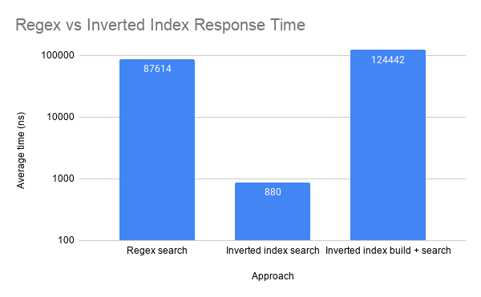

# CS622 Homework 3: Regex vs Inverted Index Search

This program counts how often three words ("learn", "hours", "language") appear
in the `data.json` file which contains data gathered from the API in Homework 2. We are using two approaches
the first approach is what we used for Homework 2, being Regex.
The second approach is one I selected being Inverted Index Search.

## Approaches
1. **Regex:** `WordSearcher` compiles a word boundary for each word, and scans the entire text with `Matcher.find()`
2. **Inverted Index:** `InvertedIndex` splits the text into words and maps each word to a list of positions where the word appears.

## Lambda Functions
- `buildIndex`: `computeIfAbsent(word, key -> new ArrayList<>())` to create a list that holds the position for the first time a word is seen.
- `searchWords`: `forEach(word -> wordCounts.put(...))` counts each search word.
- `SearchComparison`: `forEach((word, count) -> ...)` prints the results.

## Big-O 
n = the length of the text (chars)

- **Regex Search:** Is O(n*m), where m is the length of the word being searched. Regex has to read through the whole text every time it looks for a word.
- **Inverted Index:** Is O(n) as it builds once, and then it is O(1) per search. Inverted Index builds the index after running the first time, and each search is a simple hash lookup.

## Results
I decided to find the average of 1000 runs, given that the data fetched from the API was small, and simply running it once
would provide very volatile results.
**Results in nanoseconds**
- **Regex Search (3 words):** 87,614ns
- **Inverted Index Search (3 words):** 800ns
- **Inverted Index Build + Search:** 124,442ns

Searching the index is significantly faster than the regex search given that the index has been built and searched. 
The inverted index significantly outpreforms regex from the second search onwards.

## How to Run
JDK26. Make sure the `data.json` file is in the project root, and run `SearchComparison.main()` or the `SearchComparison.java` file.
All results are saved into a `timing_results.csv` file.